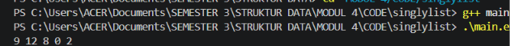
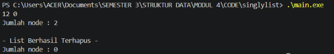

# <h1 align="center">Laporan Praktikum Modul 4 - Singly Linked List (Bagian Pertama)</h1>
<p align="center">Muhammad Rozi Lazuardi - 109082500188</p>

## Dasar Teori


### 1. Pengertian Linked List
*Linked list* (list berantai) adalah salah satu bentuk struktur data linier yang berupa serangkaian elemen data (node) yang saling berkaitan secara dinamis menggunakan pointer. Berbeda dengan array yang bersifat statis dan ukurannya telah ditentukan sejak awal, *linked list* bersifat fleksibel karena alokasi memori dapat bertambah atau berkurang (tumbuh dan mengerut) sesuai dengan kebutuhan program selama waktu eksekusi (*runtime*).

### 2. Singly Linked List
*Singly Linked List* adalah salah satu model *Abstract Data Type* (ADT) *linked list* yang memiliki karakteristik hanya mempunyai satu arah pointer penunjuk, yaitu pointer `next`. Setiap node di dalam *singly linked list* terbagi menjadi dua bagian utama:
* **Info / Data:** Bagian yang berfungsi untuk menyimpan informasi atau nilai utama dari suatu elemen (misalnya tipe data `int` atau record mahasiswa).
* **Next (Successor):** Bagian pointer yang berfungsi sebagai penghubung untuk menunjuk ke alamat node berikutnya di dalam memori.

Sifat utama dari *singly linked list* meliputi:
1. Hanya memerlukan sebuah pointer penunjuk utama yang biasa disebut sebagai `First` atau `Head` untuk mengakses elemen pertama.
2. Node atau elemen terakhir pada list akan menunjuk ke nilai kosong (`NULL` atau `Nil`) sebagai tanda akhir dari list.
3. Pembacaan atau penelusuran data dilakukan secara sekuensial satu arah dari depan ke belakang.

### 3. Operasi Dasar (Primitif) pada Singly Linked List
Pengelolaan data di dalam *singly linked list* melibatkan beberapa operasi primitif standar, antara lain:
* **Create List:** Proses inisialisasi awal untuk membentuk sebuah list kosong dengan mengeset pointer `First` bernilai `Nil`.
* **Alokasi dan Dealokasi:** Alokasi adalah proses pemesanan ruang memori dinamis untuk membentuk node baru, sedangkan dealokasi adalah proses pengembalian memori node ke sistem saat data sudah tidak digunakan lagi.
* **Insert (Penyisipan):** Metode untuk memasukkan elemen baru ke dalam list. Penyisipan dapat dilakukan di awal list (`insertFirst`), di akhir list (`insertLast`), maupun di tengah setelah node tertentu (`insertAfter`).
* **Delete (Penghapusan):** Metode untuk mengambil atau menghapus elemen dari list. Penghapusan dapat dilakukan pada elemen pertama (`deleteFirst`), elemen terakhir (`deleteLast`), setelah node tertentu (`deleteAfter`), maupun penghapusan seluruh isi list (`deleteList`).
* **View & nbList:** Operasi penelusuran (*traversing*) untuk mengunjungi dan menampilkan seluruh isi informasi node ke layar (`printInfo`), serta fungsi untuk menghitung jumlah total node yang aktif di dalam list (`nbList`).

## Guided 

### 1. Mahasiswa

```C++
list.h
#ifndef LIST_H
#define LIST_H
#define Nil NULL

#include <iostream>
using namespace std;

struct mahasiswa {
    string nama;
    string nim;
    int umur;
};

typedef mahasiswa dataMahasiswa;

typedef struct node *address;

struct node {
    dataMahasiswa isidata;
    address next;
};

struct linkedList {
    address first;
};

bool isEmpty(linkedList List);
void createlist(linkedList &List);
address alokasi(string nama, string nim, int umur);
void dealokasi(address &node);
void printList(linkedList List);
void insertFirst(linkedList &List, address nodeBaru);
void insertAfter(linkedList &List, address nodeBaru, address Prev);
void insertLast(linkedList &List, address nodeBaru);

void delFirst(linkedList &List);
void delLast(linkedList &List);
void delAfter(linkedList &List, address nodeHapus, address nodePrev);
int nbList(linkedList List);
void deleteList(linkedList &List);

#endif

list.cpp
#include "list.h"
#include <iostream>
using namespace std;

bool isEmpty(linkedList List) {
    if(List.first == Nil){
        return true;
    } else {
        return false;
    }
}

void createlist(linkedList &List) {
    List.first = Nil;
}

address alokasi(string nama, string nim, int umur) {
    address nodeBaru = new node;
    nodeBaru->isidata.nama = nama;
    nodeBaru->isidata.nim = nim;
    nodeBaru->isidata.umur = umur;
    nodeBaru->next = Nil;
    return nodeBaru;
}

void dealokasi(address &node) {
    node->next = Nil;
    delete node;
}

void insertFirst(linkedList &List, address nodeBaru) {
    nodeBaru->next = List.first;
    List.first = nodeBaru;
}

void insertAfter(linkedList &List, address nodeBaru, address Prev) {
    if (Prev != Nil) {
        nodeBaru->next = Prev->next;
        Prev->next = nodeBaru;
    } else {
        cout << "Node sebelumnya tidak valid!" << endl;
    }
}

void insertLast(linkedList &List, address nodeBaru) {
    if (isEmpty(List)) {
        List.first = nodeBaru;
    } else {
        address nodeBantu = List.first;
        while (nodeBantu->next != Nil) {
            nodeBantu = nodeBantu->next;
        }
        nodeBantu->next = nodeBaru;
    }
}

void delFirst(linkedList &List) {
    address nodeHapus;
    if (isEmpty(List) == false) {
        nodeHapus = List.first;
        List.first = List.first->next;
        nodeHapus->next = Nil;
        dealokasi(nodeHapus);
    } else {
        cout << "List kosong!" << endl;
    }
}

void delLast(linkedList &List) {
    address nodeHapus, nodePrev;
    if (isEmpty(List) == false) {
        nodeHapus = List.first;
        if (nodeHapus->next == Nil){
            List.first = Nil;
            dealokasi(nodeHapus);
        } else {
            while(nodeHapus->next != Nil){
                nodePrev = nodeHapus;
                nodeHapus = nodeHapus->next;
            }
            nodePrev->next = Nil;
            dealokasi(nodeHapus);
        }
    } else {
        cout << "list kosong" << endl;
    }
}

void delAfter(linkedList &List, address nodeHapus, address nodePrev) {
    if (isEmpty(List) == true) {
        cout << "List kosong!" << endl;
    } else {
        if (nodePrev != Nil && nodePrev->next != Nil) {
            nodeHapus = nodePrev->next;
            nodePrev->next = nodeHapus->next;
            nodeHapus->next = Nil;
            dealokasi(nodeHapus);
        } else {
            cout << "Node sebelumnya (prev) tidak valid!" << endl;
        }
    }
}

void printList(linkedList List) {
    if (isEmpty(List)) {
        cout << "List kosong." << endl;
    } else {
        address nodeBantu = List.first;
        while (nodeBantu != Nil) {
            cout << "Nama : " << nodeBantu->isidata.nama << ", NIM : " << nodeBantu->isidata.nim << ", Usia : " << nodeBantu->isidata.umur << endl;
            nodeBantu = nodeBantu->next;
        }
    }
}

int nbList(linkedList List) {
    int count = 0;
    address nodeBantu = List.first;
    while (nodeBantu != Nil) {
        count++;
        nodeBantu = nodeBantu->next;
    }
    return count;
}

void deleteList(linkedList &List) {
    address nodeHapus, nodeBantu;
    nodeBantu = List.first;
    while(nodeBantu != Nil){
        nodeHapus = nodeBantu;
        nodeBantu = nodeBantu->next;
        dealokasi(nodeHapus);
    }
    List.first = Nil;
    cout << "List sudah terhapus!" << endl;
}

main.cpp

#include "list.h"
#include <iostream>
using namespace std;

int main(){
    linkedList List;
    address nodeA, nodeB, nodeC, nodeD, nodeE = Nil;
    createlist(List);
    
    dataMahasiswa mhs;
    
    nodeA = alokasi("Dhimas", "2311102151", 20);
    nodeB = alokasi("Arvin", "231110014", 21);
    nodeC = alokasi("Rizal", "231110029", 20);
    nodeD = alokasi("Satrio", "2211102173", 21);
    nodeE = alokasi("Joshua", "2311102133", 21);
    
    insertFirst(List, nodeA);
    insertLast(List, nodeB);
    insertAfter(List, nodeC, nodeA);
    insertAfter(List, nodeD, nodeC);
    insertLast(List, nodeE);
    
    cout << "--- ISI LIST SETELAH DILAKUKAN INSERT ---" << endl;
    printList(List);
    cout << "jumlah node : " << nbList(List) << endl;
    cout << endl;
    
    delFirst(List);
    delLast(List);
    delAfter(List, nodeD, nodeC);
    
    cout << "--- ISI LIST SETELAH DILAKUKAN DELETE ---" << endl;
    printList(List);
    cout << "jumlah node : " << nbList(List) << endl;
    cout << endl;
    
    deleteList(List);
    cout << "--- ISI LIST SETELAH DILAKUKAN HAPUS LIST ---" << endl;
    printList(List);
    cout << "jumlah node : " << nbList(List) << endl;
    cout << endl;
    
    return 0;
}
```
Program di atas berfungsi untuk menyimpan dan mengorganisir data mahasiswa berbasis Singly Linked List. Proses diawali dengan menginisialisasi list melalui fungsi createlist() agar menunjuk ke kondisi kosong, diikuti dengan pembentukan node data individu (berisi identitas nama, NIM, serta usia) memakai fungsi alokasi(). Data-data tersebut lantas dirangkai ke dalam rantai linked list dengan memanfaatkan variasi fungsi penyisipan, yaitu insertFirst(), insertLast(), dan insertAfter(). Untuk memverifikasi susunan dan menghitung total data awal, program memanggil fungsi printList() beserta nbList(). Setelah itu, dilakukan pengujian eliminasi elemen secara spesifik menggunakan fungsi delFirst(), delLast(), dan delAfter(), lalu hasilnya dicetak kembali ke layar. Pada bagian akhir, fungsi deleteList() dieksekusi berguna untuk menghapus seluruh node yang ada hingga memori bersih dan list kembali bernilai kosong.


## Unguided 

### 1. Buatlah ADT Singly Linked list sebagai berikut di dalam file “Singlylist.h”, Kemudian buatlah implementasi dari procedure-procedure yang digunakan didalam file “Singlylist.cpp”, Kemudian buat program utama didalam file “main.cpp” dengan implementasi sebagai berikut.

```C++
Singlylist.h
#ifndef SINGLYLIST_H_INCLUDED
#define SINGLYLIST_H_INCLUDED

#include <iostream>

#define Nil NULL

using namespace std;

typedef int infotype;
typedef struct ElmList *address;

struct ElmList {
    infotype info;
    address next;
};

struct List {
    address First;
};

void createList(List &L);
address alokasi(infotype x);
void dealokasi(address &P);
void printInfo(List L);
void insertFirst(List &L, address P);

#endif

Singlylist.cpp
#include "Singlylist.h"

void createList(List &L) {
    L.First = Nil;
}

address alokasi(infotype x) {
    address P = new ElmList;
    if (P != Nil) {
        P->info = x;
        P->next = Nil;
    }
    return P;
}

void dealokasi(address &P) {
    delete P;
    P = Nil;
}

void printInfo(List L) {
    address P = L.First;
    while (P != Nil) {
        cout << P->info << " ";
        P = P->next;
    }
    cout << endl;
}

void insertFirst(List &L, address P) {
    if (P != Nil) {
        P->next = L.First;
        L.First = P;
    }
}

main.cpp
#include "Singlylist.h"

int main() {
    List L;
    address P1, P2, P3, P4, P5 = Nil;

    createList(L);

    P1 = alokasi(2);
    insertFirst(L, P1);

    P2 = alokasi(0);
    insertFirst(L, P2);

    P3 = alokasi(8);
    insertFirst(L, P3);

    P4 = alokasi(12);
    insertFirst(L, P4);

    P5 = alokasi(9);
    insertFirst(L, P5);

    printInfo(L);

    return 0;
}
```
### Output Unguided 1 :

##### Output 



Program di atas digunakan untuk mengelola data berbasis Singly Linked List dengan tipe informasi berupa integer. Langkah awal program membentuk list kosong menggunakan createList(), kemudian mengalokasikan memori untuk lima node baru yang masing-masing diisi nilai 2, 0, 8, 12, dan 9 menggunakan fungsi alokasi(). Seluruh node tersebut dimasukkan ke dalam list secara berurutan di bagian awal menggunakan prosedur insertFirst(). Terakhir, program memanggil printInfo() untuk menelusuri dan menampilkan seluruh isi elemen yang tersimpan di dalam list ke layar.

### 2. Dari soal Latihan pertama, lakukan penghapusan node 9 menggunakan deleteFirst(), node 2 menggunakan deleteLast(), dan node 8 menggunakan deleteAfter(). Kemudian tampilkan jumlah node yang tersimpan menggunakan nbList() dan lakukan penghapusan seluruh node menggunakan deleteList().

```C++
Singlylist.h
#ifndef SINGLYLIST_H_INCLUDED
#define SINGLYLIST_H_INCLUDED

#include <iostream>

#define Nil NULL

using namespace std;

typedef int infotype;
typedef struct ElmList *address;

struct ElmList {
    infotype info;
    address next;
};

struct List {
    address First;
};

void createList(List &L);
address alokasi(infotype x);
void dealokasi(address &P);
void printInfo(List L);
void insertFirst(List &L, address P);

void deleteFirst(List &L, address &P);
void deleteLast(List &L, address &P);
void deleteAfter(address Prec, address &P);
int nbList(List L);
void deleteList(List &L);

#endif

Singlylist.cpp
#include "Singlylist.h"

void createList(List &L) {
    L.First = Nil;
}

address alokasi(infotype x) {
    address P = new ElmList;
    if (P != Nil) {
        P->info = x;
        P->next = Nil;
    }
    return P;
}

void dealokasi(address &P) {
    delete P;
    P = Nil;
}

void printInfo(List L) {
    address P = L.First;
    while (P != Nil) {
        cout << P->info << " ";
        P = P->next;
    }
    cout << endl;
}

void insertFirst(List &L, address P) {
    if (P != Nil) {
        P->next = L.First;
        L.First = P;
    }
}

void deleteFirst(List &L, address &P) {
    if (L.First != Nil) {
        P = L.First;
        L.First = L.First->next;
        P->next = Nil;
    } else {
        P = Nil;
    }
}

void deleteLast(List &L, address &P) {
    if (L.First != Nil) {
        if (L.First->next == Nil) {
            P = L.First;
            L.First = Nil;
        } else {
            address Q = L.First;
            while (Q->next->next != Nil) {
                Q = Q->next;
            }
            P = Q->next;
            Q->next = Nil;
        }
    } else {
        P = Nil;
    }
}

void deleteAfter(address Prec, address &P) {
    if (Prec != Nil && Prec->next != Nil) {
        P = Prec->next;
        Prec->next = P->next;
        P->next = Nil;
    } else {
        P = Nil;
    }
}

int nbList(List L) {
    int count = 0;
    address P = L.First;
    while (P != Nil) {
        count++;
        P = P->next;
    }
    return count;
}

void deleteList(List &L) {
    address P;
    while (L.First != Nil) {
        deleteFirst(L, P);
        dealokasi(P);
    }
    cout << "- List Berhasil Terhapus -" << endl;
}

main.cpp
#include "Singlylist.h"

int main() {
    List L;
    address P1, P2, P3, P4, P5 = Nil;
    address PDel;

    createList(L);

    P1 = alokasi(2);
    insertFirst(L, P1);

    P2 = alokasi(0);
    insertFirst(L, P2);

    P3 = alokasi(8);
    insertFirst(L, P3);

    P4 = alokasi(12);
    insertFirst(L, P4);

    P5 = alokasi(9);
    insertFirst(L, P5);

    deleteFirst(L, PDel);
    dealokasi(PDel);

    deleteLast(L, PDel);
    dealokasi(PDel);

    deleteAfter(L.First, PDel);
    dealokasi(PDel);

    printInfo(L);
    cout << "Jumlah node : " << nbList(L) << endl << endl;

    deleteList(L);
    cout << "Jumlah node : " << nbList(L) << endl;

    return 0;
}
```
### Output Unguided 2 :

##### Output 



Program di atas digunakan untuk mengelola data Singly Linked List yang diawali dengan membentuk list kosong melalui createList() serta memasukkan lima elemen node ke bagian awal menggunakan alokasi() dan insertFirst(). Setelah rangkaian data terbentuk, program melakukan penghapusan node secara bertahap menggunakan fungsi deleteFirst(), deleteLast(), dan deleteAfter(), lalu menampilkan sisa elemen bersama total node yang tersisa menggunakan printInfo() dan nbList(). Pada bagian akhir, seluruh struktur memori list dibersihkan secara total menggunakan prosedur deleteList() sehingga list kembali kosong dengan jumlah node bernilai nol.


## Kesimpulan
Kesimpulan dari keseluruhan rangkaian praktikum Singly Linked List ini adalah bahwa struktur data berbasis pointer dinamis ini memungkinkan pengelolaan data secara fleksibel, baik melalui proses penambahan elemen di awal (insertFirst), penghapusan elemen secara spesifik di berbagai posisi (deleteFirst, deleteLast, deleteAfter), maupun penelusuran serta penghitungan jumlah node (printInfo dan nbList). Berdasarkan hasil pengujian pada latihan pertama dan kedua, seluruh operasi primitif tersebut dapat diimplementasikan dengan baik menggunakan pembagian file modular (.h dan .cpp), sehingga pemanfaatan memori dapat dialokasikan dan dibersihkan kembali secara efisien menggunakan fungsi dealokasi dan deleteList() hingga list kembali kosong.

## Referensi
[1] Munir, Rinaldi. (2016). Algoritma dan Pemrograman dalam Bahasa C dan C++. Bandung: Informatika.
<br>[2] Cormen, T. H., Leiserson, C. E., Rivest, R. L., & Stein, C. (2009). Introduction to Algorithms (3rd ed.). MIT Press.
<br>[3] Malik, D. S. (2017). C++ Programming: From Problem Analysis to Program Design (8th ed.). Cengage Learning.
<br>[4] Tim Dosen Struktur Data. (2026). Modul Praktikum Struktur Data: Singly Linked List (Bagian Pertama). Fakultas Informatika, Telkom University.