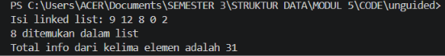

# <h1 align="center">Laporan Praktikum Modul 5 - SINGLY LINKED LIST  (Bagian Kedua)</h1>
<p align="center">Muhammad Rozi lazuardi - 109082500188</p>

## Dasar Teori
Linked list atau yang sering disebut senarai berantai merupakan salah satu struktur data linear dinamis yang terdiri dari kumpulan simpul atau node yang saling terhubung menggunakan pointer  Setiap node dalam linked list memuat dua komponen utama, yaitu medan informasi (info/data) yang menyimpan nilai serta medan penunjuk (next) yang mereferensikan alamat memori dari node berikutnya  Berbeda dengan struktur data statis seperti array, linked list memiliki keunggulan dalam hal fleksibilitas alokasi memori yang bersifat dinamis, sehingga penambahan maupun pengurangan elemen dapat dilakukan secara efisien tanpa harus mendefinisikan kapasitas maksimum di awal 

### A. Konsep Dasar Singly Linked List<br/>
Singly linked list adalah varian paling sederhana dari struktur data berantai di mana penelusuran elemen hanya dapat dilakukan dalam satu arah saja, yaitu dari node awal menuju node akhir Setiap node hanya memiliki satu buah pointer penunjuk (next) yang mengarah ke node sesudahnya, sementara node terakhir akan menunjuk ke nilai penanda kosong atau NULL.
#### 1. Node dan Struktur Elemen
Node merupakan komponen pembangun utama pada linked list yang terbagi menjadi dua bagian penting, yaitu bagian info yang berfungsi menyimpan nilai atau data utama, serta bagian next yang bertindak sebagai pointer pemegang alamat memori dari node selanjutnya. Pembuatan node baru dilakukan dengan alokasi memori dinamis (new), sedangkan penghapusan node memanfaatkan prosedur dealokasi (delete) untuk mengembalikan memori kembali ke sistem.

#### 2. Pointer First (Head)
Pointer First atau biasa dikenal sebagai Head berfungsi sebagai penanda awal dan pintu masuk tunggal untuk mengakses seluruh elemen di dalam linked list. Jika nilai dari pointer First bernilai NULL, maka linked list tersebut dinyatakan berada dalam keadaan kosong (empty list).
#### 3. Operasi Alokasi dan Dealokasi Memori
Manajemen memori dinamis pada linked list melibatkan fungsi alokasi untuk memesan blok memori baru saat terjadi penambahan elemen, serta prosedur dealokasi guna mengembalikan blok memori node yang sudah tidak terpakai kembali ke sistem agar terhindar dari kebocoran memori (memory leak).

### B. Operasi Dasar pada Singly Linked List<br/>
Pengoperasian pada singly linked list melibatkan manipulasi pointer untuk menambahkan, menghapus, memperbarui, maupun mencari data di dalam list secara terstruktur.
#### 1. Pembuatan List (CreateList)
Operasi inisialisasi awal yang digunakan untuk membentuk sebuah struktur list baru dengan cara menyetujui pointer First bernilai NULL. Proses ini memastikan bahwa list siap digunakan dan belum menunjuk ke alamat memori manapun.


#### 2. Penambahan Elemen (Insertion)
Operasi penyisipan data baru dapat dilakukan di berbagai posisi sesuai kebutuhan algoritma, seperti di awal list (insertFirst), di akhir list (insertLast), maupun di antara node tertentu (insertAfter). Penambahan elemen di awal list (insertFirst) dilakukan dengan menyambungkan pointer next dari node baru ke node pertama lama, kemudian memperbarui pointer First mengarah ke node baru.
#### 3. Penelusuran, Pencarian, dan Pengolahan Data (Traversal & Searching)
Operasi penelusuran (traversal) dilakukan untuk mengakses dan memproses setiap elemen dari awal hingga akhir list. Proses penelusuran ini menjadi dasar dalam fungsi menampilkan isi list (printInfo), pencarian elemen berdasarkan nilai tertentu (findElm), hingga kalkulasi data seperti akumulasi total seluruh nilai elemen di dalam list (totalInfo).


## Guided 

### 1. Buah

```C++
listBuah.h
//Header guard digunakan untuk mencegah file header yang sama 
  //di-include lebih dari sekali dalam satu program.
  #ifndef LISTBUAH_H
  #define LISTBUAH_H
  #define Nil NULL

  #include<iostream>
  using namespace std;

  struct buah{
      string nama;
      int jumlah; 
      float harga;
  };

  typedef buah dataBuah; //Memberikan nama alias databuah untuk struct buah.

  typedef struct node *address; //Mendefinisikan alias address sebagai pointer ke struct node

  struct node{ // node untuk isi dari linked listnya, isi setiap node adalah data & pointer next
      dataBuah isidata;
      address next;
  };

  struct linkedlist{ //ini linked list nya
      address first;
  };

  //semua function & prosedur yang akan dipakai
  //Materi modul 4
  bool isEmpty(linkedlist List);
  void createList(linkedlist &List);
  address alokasi(string nama, int jumlah, float harga);
  void dealokasi(address &node);
  void printList(linkedlist List);
  void insertFirst(linkedlist &List, address nodeBaru);
  void insertAfter(linkedlist &List, address nodeBaru, address Prev);
  void insertLast(linkedlist &List, address nodeBaru);
  void delFirst(linkedlist &List);
  void delLast(linkedlist &List);
  void delAfter(linkedlist &List, address nodeHapus, address nodePrev);
  int nbList(linkedlist List);
  void deleteList(linkedlist &List);

  //materi modul 5 (update)
  void updateFirst(linkedlist List);
  void updateLast(linkedlist List);
  void updateAfter(linkedlist List, address prev);

  //materi modul 5 (searching)
  void FindNodeByData(linkedlist list, string data);
  void FindNodeByAddress(linkedlist list, address node);
  void FindNodeByRange(linkedlist list, float hargaAwal, float HargaAkhir);

  #endif

listBuah.cpp
#include "listBuah.h"
#include <iostream>
using namespace std;

//fungsi untuk cek apakah list kosong atau tidak
bool isEmpty(linkedlist List) {
    if(List.first == Nil){
        return true; 
    } else {
        return false;
    }
}

//pembuatan linked list kosong
void createList(linkedlist &List) {
    List.first = Nil;
}

//pembuatan node baru dengan menerapkan manajemen memori
address alokasi(string nama, int jumlah, float harga) { 
    address nodeBaru = new node; 
    nodeBaru->isidata.nama = nama;
    nodeBaru->isidata.jumlah = jumlah; 
    nodeBaru->isidata.harga = harga;
    nodeBaru->next = Nil;
    return nodeBaru;
}

//penghapusan node dengan menerapkan manajemen memori
void dealokasi(address &node) {
    node->next = Nil;
    delete node;
}

//prosedur-prosedur untuk insert / menambahkan node baru kedalam list
void insertFirst(linkedlist &List, address nodeBaru) {
    nodeBaru->next = List.first; 
    List.first = nodeBaru;
}

void insertAfter(linkedlist &List, address nodeBaru, address Prev) {
    if (Prev != Nil) {
        nodeBaru->next = Prev->next;
        Prev->next = nodeBaru;
    } else {
        cout << "Node sebelumnya tidak valid!" << endl;
    }
}

void insertLast(linkedlist &List, address nodeBaru) {
    if (isEmpty(List)) {
        List.first = nodeBaru;
    } else {
        address nodeBantu = List.first;
        while (nodeBantu->next != Nil) {
            nodeBantu = nodeBantu->next;
        }
        nodeBantu->next = nodeBaru;
    }
}

//prosedur-prosedur untuk delete / menghapus node yang ada didalam list
void delFirst(linkedlist &List){
    address nodeHapus;
    if (isEmpty(List) == false) {
        nodeHapus = List.first;
        List.first = List.first->next;
        nodeHapus->next = Nil;
        dealokasi(nodeHapus);
        cout << "Node pertama berhasil terhapus!" << endl;
    } else {
        cout << "List kosong!" << endl;
    }
}

void delLast(linkedlist &List){
    address nodeHapus, nodePrev;
    if(isEmpty(List) == false){
        nodeHapus = List.first;
        if(nodeHapus->next == Nil){
            List.first->next = Nil;
            dealokasi(nodeHapus);
        } else { 
            while(nodeHapus->next != Nil){
                nodePrev = nodeHapus; 
                nodeHapus = nodeHapus->next;
            }
            nodePrev->next = Nil; 
            dealokasi(nodeHapus);
        }
        cout << "Node terakhir berhasil terhapus!" << endl;
    } else {
        cout << "list kosong" << endl;
    }
}

void delAfter(linkedlist &List, address nodeHapus, address nodePrev){
    if(isEmpty(List) == true){
        cout << "List kosong!" << endl;
    } else { //jika list tidak kosong
        if (nodePrev != Nil && nodePrev->next != Nil) { 
            nodeHapus = nodePrev->next;       
            nodePrev->next = nodeHapus->next;  
            nodeHapus->next = Nil;         
            dealokasi(nodeHapus);
            cout << "Node setelah node " << nodePrev->isidata.nama << " berhasil terhapus!" << endl;
        } else {
            cout << "Node sebelumnya (prev) tidak valid!" << endl;
        }
    }
}

//prosedur untuk menampilkan isi list
void printList(linkedlist List) {
    if (isEmpty(List)) {
        cout << "List kosong." << endl;
    } else {
        address nodeBantu = List.first;
        while (nodeBantu != Nil) { 
            cout << "Nama Buah : " << nodeBantu->isidata.nama << ", Jumlah : " << nodeBantu->isidata.jumlah << ", Harga : " << nodeBantu->isidata.harga << endl;
            nodeBantu = nodeBantu->next;
        }
    }
}

//function untuk menampilkan jumlah node didalam list
int nbList(linkedlist List) {
    int count = 0;
    address nodeBantu = List.first;
    while (nodeBantu != Nil) {
        count++;
        nodeBantu = nodeBantu->next; 
    }
    return count;
}

//prosedur untuk menghapus list (menghapus semua node didalam list)
void deleteList(linkedlist &List){
    address nodeBantu, nodeHapus;
    nodeBantu = List.first;
    while(nodeBantu != Nil){
        nodeHapus = nodeBantu;
        nodeBantu = nodeBantu->next;
        dealokasi(nodeHapus); 
    }
    List.first = Nil; 
    cout << "List berhasil terhapus!" << endl;
}

/*----- MATERI PERTEMUAN 5 - SINGLY LINKED LIST (BAGIAN KEDUA) - UPDATE -----*/
//prosedur-prosedur untuk melakukan update data node
void updateFirst(linkedlist List){
    if(isEmpty(List) == true){
        cout << "List kosong!" << endl;
    } else {
        cout << "Masukkan update data node pertama : " << endl;
        cout << "Nama buah : ";
        cin >> List.first->isidata.nama;
        cout << "Jumlah : ";
        cin >> List.first->isidata.jumlah;
        cout << "Harga : ";
        cin >> List.first->isidata.harga;
        cout << "Data Berhasil Diupdate!" << endl;
        cout << endl;
    }
}

void updateLast(linkedlist List){
    if (isEmpty(List) == true) {
        cout << "List Kosong!" << endl;
    } else {
        address nodeBantu = List.first;
        while (nodeBantu->next != Nil) {
            nodeBantu = nodeBantu->next;
        }
        cout << "masukkan update data node terakhir : " << endl;
        cout << "Nama buah : ";
        cin >> nodeBantu->isidata.nama;
        cout << "Jumlah : ";
        cin >> nodeBantu->isidata.jumlah;
        cout << "Harga : ";
        cin >> nodeBantu->isidata.harga;
        cout << "Data Berhasil Diupdate!" << endl;
        cout << endl;
    }
}

void updateAfter(linkedlist List, address nodePrev){
    if(isEmpty(List) == true){
        cout << "List kosong!" << endl;
    } else {
        if (nodePrev != Nil && nodePrev->next != Nil){
            address nodeBantu = nodePrev->next;
            cout << "masukkan update data node setelah node " << nodePrev->isidata.nama << " : " << endl;
            cout << "Nama buah : ";
            cin >> nodeBantu->isidata.nama;
            cout << "Jumlah : ";
            cin >> nodeBantu->isidata.jumlah;
            cout << "Harga : ";
            cin >> nodeBantu->isidata.harga;
            cout << "Data Berhasil Diupdate!" << endl;
            cout << endl;
        } else {
            cout << "Node sebelumnya (prev) tidak valid!" << endl;
        }
    }
}

/*----- MATERI PERTEMUAN 5 - SINGLY LINKED LIST (BAGIAN KEDUA) - SEARCHING -----*/
//prosedur-prosedur untuk searching data
//prosedur untuk mencari node berdasarkan data
void FindNodeByData(linkedlist list, string data){
    if(isEmpty(list) == true){
        cout << "List kosong!" << endl;
    } else {
        address nodeBantu = list.first;
        int posisi = 0;
        bool found = false;
        while(nodeBantu != Nil){
            posisi++;
            if(nodeBantu->isidata.nama == data){
                cout << "Data " << data << " ditemukan pada posisi ke-" << posisi << "!" << endl;
                cout << "Nama Buah : " << nodeBantu->isidata.nama << ", Jumlah : " << nodeBantu->isidata.jumlah << ", Harga : " << nodeBantu->isidata.harga << endl;
                found = true;
                break;
            }
            nodeBantu = nodeBantu->next;
        }   
        if(found == false){
            cout << "Node dengan data " << data << " tidak ditemukan!" << endl;
        }
    }
    cout << endl;
}

//prosedur untuk mencari node berdasarkan alamat node
void FindNodeByAddress(linkedlist list, address node) {
    if(isEmpty(list) == true) {
        cout << "List kosong!" << endl;
    } else {
        address nodeBantu = list.first;
        int posisi = 0;
        bool found = false;
        while (nodeBantu != Nil) {
            posisi++;
            if(nodeBantu == node) {
                cout << "Node ditemukan pada posisi ke-" << posisi << "!" << endl;
                cout << "Alamat node : " << nodeBantu << endl;
                cout << "Nama Buah : " << nodeBantu->isidata.nama << ", Jumlah : " << nodeBantu->isidata.jumlah << ", Harga : " << nodeBantu->isidata.harga << endl;
                found = true;
                break;
            }
            nodeBantu = nodeBantu->next;
        }
        if(found == false) {
            cout << "Node dengan alamat " << node << " tidak ditemukan dalam list!" << endl;
        }
    }
    cout << endl;
}

//prosedur untuk mencari node berdasarkan range data (range harga)
void FindNodeByRange(linkedlist list, float hargaAwal, float hargaAkhir) {
    if(isEmpty(list) == true) {
        cout << "List kosong!" << endl;
    } else {
        address nodeBantu = list.first;
        int posisi = 0;
        bool found = false;
        cout << "--- Buah dalam range harga " << hargaAwal << " - " << hargaAkhir << " ---" << endl;
        cout << "-------------------------------------------" << endl;
        while (nodeBantu != Nil) {
            posisi++;
            float harga = nodeBantu->isidata.harga;
            if(harga >= hargaAwal && harga <= hargaAkhir) {
                cout << "Data ditemukan pada posisi ke-" << posisi << " :" << endl;
                cout << "Nama Buah : " << nodeBantu->isidata.nama << ", Jumlah : " << nodeBantu->isidata.jumlah << ", Harga : " << nodeBantu->isidata.harga << endl;
                cout << "-------------------------------------------" << endl;
                found = true;
            }
            nodeBantu = nodeBantu->next;
        }
        if(found == false) {
            cout << "Tidak ada data buah dalam range harga tersebut!" << endl;
            cout << "-------------------------------------------" << endl;
        }
    }
}

main.cpp
#include "listBuah.h"

#include<iostream>
using namespace std;

int main(){
    linkedlist List;
    address nodeA, nodeB, nodeC, nodeD, nodeE = Nil;
    createList(List);

    dataBuah dtBuah;

    nodeA = alokasi("Jeruk", 100, 3000);
    nodeB = alokasi("Apel", 75, 4000);
    nodeC = alokasi("Pir", 87, 5000);
    nodeD = alokasi("Semangka", 43, 11500);
    nodeE = alokasi("Durian", 15, 31450);

    insertFirst(List, nodeA);
    insertLast(List, nodeB);
    insertAfter(List, nodeC, nodeA);
    insertAfter(List, nodeD, nodeC);
    insertLast(List, nodeE);

    cout << "--- ISI LIST SETELAH DILAKUKAN INSERT ---" << endl;
    printList(List);
    cout << "jumlah node : " << nbList(List) << endl;
    cout << endl;

    updateFirst(List);
    printList(List);
    updateLast(List);
    printList(List);
    updateAfter(List, nodeD);
    printList(List);
    
    cout << "--- ISI LIST SETELAH DILAKUKAN UPDATE ---" << endl;
    printList(List);
    cout << "jumlah node : " << nbList(List) << endl;
    cout << endl;
    
    FindNodeByData(List, "kelapa");
    FindNodeByAddress(List, nodeC);
    FindNodeByRange(List, 5000, 10000);
    
    delFirst(List);
    printList(List);
    delLast(List);
    printList(List);
    delAfter(List, nodeD, nodeC);
    printList(List);

    cout << "--- ISI LIST SETELAH DILAKUKAN DELETE ---" << endl;
    printList(List);
    cout << "jumlah node : " << nbList(List) << endl;
    cout << endl;

    deleteList(List);
    cout << "--- ISI LIST SETELAH DILAKUKAN HAPUS LIST ---" << endl;
    printList(List);
    cout << "jumlah node : " << nbList(List) << endl;
    cout << endl;
    
    return 0;
}
```
Program di atas digunakan untuk mengelola inventaris buah dengan menerapkan konsep Singly Linked List, di mana setiap elemen node menampung atribut nama, kuantitas, serta harga buah beserta penunjuk ke node berikutnya. Eksekusi program diawali dengan pembentukan list kosong melalui createList(), dilanjutkan dengan pembuatan node baru lewat alokasi(), serta penyisipan data ke berbagai posisi menggunakan prosedur insertFirst(), insertLast(), dan insertAfter(). Keseluruhan data dalam list dapat ditampilkan ke layar melalui printList(), sementara total keseluruhan node dihitung oleh nbList(). Selain itu, program menyediakan prosedur updateFirst(), updateLast(), serta updateAfter() guna memperbarui informasi buah yang tersimpan. Mekanisme penelusuran data didukung oleh fungsi FindNodeByData() berdasarkan nama, FindNodeByAddress() berdasarkan letak memori, dan FindNodeByRange() berdasarkan batasan harga tertentu. Tahap pembersihan data memanfaatkan prosedur delFirst(), delLast(), serta delAfter() untuk penghapusan node spesifik, yang kemudian ditutup dengan pemanggilan deleteList() untuk membersihkan seluruh sisa node dari memori secara menyeluruh. Melalui serangkaian fungsi tersebut, program ini sukses mengimplementasikan seluruh operasi komprehensif pada Singly Linked List mulai dari inisialisasi, manipulasi, pembaruan, penelusuran, hingga pelepasan memori.


## Unguided 

### 1. Buatlah ADT Singly Linked list sebagai berikut di dalam file “Singlylist.h”, Kemudian buat implementasi ADT Singly Linked list pada file “Singlylist.cpp”. Carilah elemen dengan info 8 dengan membuat fungsi baru. fungsi findElm( L : List, x : infotype ) : address. Hitunglah jumlah total info seluruh elemen (9+12+8+0+2=31).

```C++
Singlylist.h

#ifndef SINGLYLIST_H
#define SINGLYLIST_H

#include <iostream>
using namespace std;

typedef int infotype;
typedef struct ElmList *address;

struct ElmList {
    infotype info;
    address next;
};

struct List {
    address First;
};

void CreateList(List &L);
address alokasi(infotype x);
void dealokasi(address &P);
void printInfo(List L);
void insertFirst(List &L, address P);
address findElm(List L, infotype x);
int totalInfo(List L);

#endif

Singlylist.cpp

#include "Singlylist.h"

void CreateList(List &L) {
    L.First = NULL;
}

address alokasi(infotype x) {
    address P = new ElmList;
    P->info = x;
    P->next = NULL;
    return P;
}

void dealokasi(address &P) {
    delete P;
    P = NULL;
}

void printInfo(List L) {
    address P = L.First;

    while (P != NULL) {
        cout << P->info;
        if (P->next != NULL) {
            cout << " ";
        }
        P = P->next;
    }
    cout << endl;
}

void insertFirst(List &L, address P) {
    P->next = L.First;
    L.First = P;
}

address findElm(List L, infotype x) {
    address P = L.First;

    while (P != NULL) {
        if (P->info == x) {
            return P;
        }
        P = P->next;
    }

    return NULL;
}

int totalInfo(List L) {
    int total = 0;
    address P = L.First;

    while (P != NULL) {
        total += P->info;
        P = P->next;
    }

    return total;
}

main.cpp

#include "Singlylist.h"

int main() {
    List L;
    address P1, P2, P3, P4, P5, hasil;

    CreateList(L);

    P1 = alokasi(2);
    insertFirst(L, P1);

    P2 = alokasi(0);
    insertFirst(L, P2);

    P3 = alokasi(8);
    insertFirst(L, P3);

    P4 = alokasi(12);
    insertFirst(L, P4);

    P5 = alokasi(9);
    insertFirst(L, P5);

    cout << "Isi linked list: ";
    printInfo(L);

    hasil = findElm(L, 8);

    if (hasil != NULL) {
        cout << hasil->info
             << " ditemukan dalam list" << endl;
    } else {
        cout << "Elemen tidak ditemukan dalam list" << endl;
    }

    cout << "Total info dari kelima elemen adalah "
         << totalInfo(L) << endl;

    return 0;
}
```
### Output Unguided 1 :

##### Output 1



## Kesimpulan
Kesimpulan dari materi Singly Linked List ini adalah bahwa struktur data linear dinamis ini menggunakan simpul atau node yang saling terhubung melalui pointer untuk mengelola data secara fleksibel tanpa batasan kapasitas di awal. Implementasi dengan konsep Abstract Data Type (ADT) yang memisahkan file header dan file implementasi membuat kode program menjadi lebih terstruktur dan modular. Berbagai operasi komprehensif mulai dari inisialisasi list kosong, manajemen memori lewat alokasi dan dealokasi, penambahan serta penghapusan elemen, hingga penelusuran dan pencarian data berhasil diterapkan secara efektif untuk mengolah informasi nilai maupun objek di dalam bahasa C++.

## Referensi
[1] Triase. (2020). Diktat Edisi Revisi : STRUKTUR DATA. Medan: UNIVERSTAS ISLAM NEGERI SUMATERA UTARA MEDAN. 
<br>[2] Indahyati, Uce., Rahmawati Yunianita. (2020). "BUKU AJAR ALGORITMA DAN PEMROGRAMAN DALAM BAHASA C++". Sidoarjo: Umsida Press. Diakses pada 10 Maret 2024 melalui https://doi.org/10.21070/2020/978-623-6833-67-4.
<br>...
