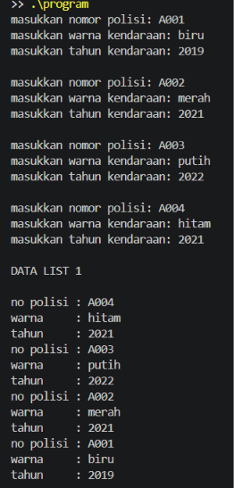
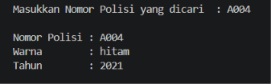
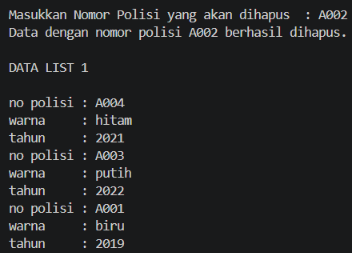

# <h1 align="center">Laporan Praktikum Modul 1 - DOUBLY LINKED LIST (BAGIAN PERTAMA)</h1>
<p align="center">Muhammad Rozi Lazuardi - 109082500188</p>

## Dasar Teori

Linked list adalah struktur data yang berisi kumpulan data tersusun secara sekuensial, saling bersambungan, dinamis, dan terbatas. Linked list terdiri dari sejumlah node yang dihubungkan secara linier dengan bantuan pointer, sehingga ukurannya dapat berubah selama program berjalan.

### A. Doubly Linked List<br/>
Doubly linked list adalah linked list yang setiap elemennya memiliki dua pointer, yaitu prev yang menunjuk ke elemen sebelumnya dan next yang menunjuk ke elemen sesudahnya. List ini juga memiliki pointer first dan last sebagai penunjuk elemen pertama dan terakhir, serta dinyatakan kosong jika first bernilai Nil.

#### 1. Komponen
Komponennya terdiri dari first, last, next, dan prev, dengan prev elemen pertama dan next elemen terakhir bernilai Nil.

#### 2. Kelebihan
Penelusuran data dapat dilakukan dua arah, maju maupun mundur, sehingga akses elemen lebih mudah dibandingkan singly linked list.

#### 3. Kekurangan
Setiap elemen membutuhkan tambahan memori untuk pointer prev.

### B. Operasi pada Doubly Linked List<br/>
Operasi dasarnya meliputi insert, delete, dan searching, dengan pointer next dan prev yang harus diatur dengan benar agar list tetap terhubung.

#### 1. Insert
Terdiri dari *insert first*, *insert last*, *insert after*, dan *insert before* untuk menambah elemen di posisi tertentu.

#### 2. Delete
Terdiri dari *delete first*, *delete last*, *delete after*, dan *delete before*, lalu elemen yang dilepas didealokasi.

#### 3. Searching
Pencarian, update, dan view dilakukan dengan menelusuri elemen satu per satu, baik dari first maupun dari last.

## Guided 

### 1. Guided

```C++
Doublylist.h
#ifndef DOUBLYLIST_H
#define DOUBLYLIST_H
#include <string>
using namespace std;

struct burung {
    string kode;
    string nama;
    int tahun;
};

using infotype = burung;
struct elmlist;
using address = elmlist*;
struct elmlist { infotype info; address prev; address next; };
struct list { address first; address last; };

void CreateList(list &L);
address alokasi(const infotype &x);
void dealokasi(address &P);
void insertFirst(list &L, address P);
void insertLast(list &L, address P);
void insertAfter(list &L, address &Prec, address P);
void insertBefore(list &L, address &Prec, address P);
void printInfo(const list &L);
address findElm(const list &L, const string &kode);
void deleteFirst(list &L, address &P);
void deleteLast(list &L, address &P);
void deleteAfter(list &L, address &Prec, address &P);
void deleteBefore(list &L, address &Succ, address &P);

#endif

Doublylist.cpp
#include <iostream>
#include <iomanip>
#include "Doublylist.h"
using namespace std;

void CreateList(list &L) { 
    L.first = nullptr; 
    L.last = nullptr; 
}

address alokasi(const infotype &x) {
    address P = new elmlist;
    P->info = x;
    P->prev = nullptr; 
    P->next = nullptr;
    return P;
}

void dealokasi(address &P) {
    if (P != nullptr) { 
        delete P; 
        P = nullptr; 
    }
}

void insertFirst(list &L, address P) {
    if (!P) return;
    P->prev = nullptr; 
    P->next = L.first;
    if (L.first) L.first->prev = P;
    else L.last = P;
    L.first = P;
}

void insertLast(list &L, address P) {
    if (!P) return;
    P->next = nullptr; 
    P->prev = L.last;
    if (L.last) L.last->next = P;
    else L.first = P;
    L.last = P;
}

void insertAfter(list &L, address &Prec, address P) {
    if (!Prec || !P) return;
    P->prev = Prec;
    P->next = Prec->next;
    if (Prec->next) Prec->next->prev = P;
    else L.last = P;
    Prec->next = P;
}

void insertBefore(list &L, address &Prec, address P) {
    if (!Prec || !P) return;
    P->next = Prec;
    P->prev = Prec->prev;
    if (Prec->prev) Prec->prev->next = P;
    else L.first = P;
    Prec->prev = P;
}

void printInfo(const list &L) {
    address P = L.first;
    if (!P) {
        cout << "List kosong.\n";
        return;
    }
    cout << "+---------------------------------------+\n";
    cout << "| Kode | Nama            | Tahun        |\n";
    cout << "+---------------------------------------+\n";
    while (P) {
        cout << "| " << left << setw(6) << P->info.kode
             << "| " << setw(15) << P->info.nama
             << "| " << setw(12) << P->info.tahun << "|\n";
        P = P->next;
    }
    cout << "+---------------------------------------+\n";
}

address findElm(const list &L, const string &kode) {
    address P = L.first;
    while (P) {
        if (P->info.kode == kode) return P;
        P = P->next;
    }
    return nullptr;
}

void deleteFirst(list &L, address &P) {
    if (!L.first) { P = nullptr; return; }
    P = L.first;
    L.first = L.first->next;
    if (L.first) L.first->prev = nullptr;
    else L.last = nullptr;
    P->prev = P->next = nullptr;
}

void deleteLast(list &L, address &P) {
    if (!L.last) { P = nullptr; return; }
    P = L.last;
    L.last = L.last->prev;
    if (L.last) L.last->next = nullptr;
    else L.first = nullptr;
    P->prev = P->next = nullptr;
}

void deleteAfter(list &L, address &Prec, address &P) {
    P = nullptr;
    if (!Prec || !Prec->next) return;
    P = Prec->next;
    Prec->next = P->next;
    if (P->next) P->next->prev = Prec;
    else L.last = Prec;
    P->prev = P->next = nullptr;
}

void deleteBefore(list &L, address &Succ, address &P) {
    P = nullptr;
    if (!Succ || !Succ->prev) return;
    P = Succ->prev;
    Succ->prev = P->prev;
    if (P->prev) P->prev->next = Succ;
    else L.first = Succ;
    P->prev = P->next = nullptr;
}

main.cpp
#include <iostream>
#include "Doublylist.h"
using namespace std;

void tampilkanJudul(const string &judul) {
    cout << "\n=================================\n";
    cout << judul << "\n";
    cout << "=================================\n";
}

int main() {
    list L;
    CreateList(L);

    infotype barang1 = {"B001", "Laptop", 2020};
    infotype barang2 = {"B002", "Monitor", 2022};
    infotype barang3 = {"B003", "Keyboard", 2023};
    infotype barang4 = {"B004", "Mouse", 2024};

    address P = nullptr;
    address posisi = nullptr;

    cout << "DEMONSTRASI OPERASI DOUBLY LINKED LIST\n";
    cout << "Data yang digunakan: B001, B002, B003, dan B004\n";

    tampilkanJudul("[1] INSERT FIRST");
    cout << "Menambahkan B002 di awal list.\n";
    insertFirst(L, alokasi(barang2));
    printInfo(L);

    tampilkanJudul("[2] INSERT LAST");
    cout << "Menambahkan B004 di akhir list.\n";
    insertLast(L, alokasi(barang4));
    printInfo(L);

    tampilkanJudul("[3] INSERT AFTER");
    cout << "Menambahkan B003 setelah B002.\n";
    posisi = findElm(L, "B002");
    if (posisi != nullptr) {
        insertAfter(L, posisi, alokasi(barang3));
    }
    printInfo(L);

    tampilkanJudul("[4] INSERT BEFORE");
    cout << "Menambahkan B001 sebelum B002.\n";
    posisi = findElm(L, "B002");
    if (posisi != nullptr) {
        insertBefore(L, posisi, alokasi(barang1));
    }
    printInfo(L);

    tampilkanJudul("[5] FIND ELEMENT");
    cout << "Mencari barang dengan kode B003.\n";
    posisi = findElm(L, "B003");
    if (posisi != nullptr) {
        cout << "Data ditemukan:\n";
        cout << " Kode : " << posisi->info.kode << "\n";
        cout << " Nama : " << posisi->info.nama << "\n";
        cout << " Tahun : " << posisi->info.tahun << "\n";
    } else {
        cout << "Data tidak ditemukan.\n";
    }

    tampilkanJudul("[6] DELETE AFTER");
    cout << "Menghapus node setelah B002 (B003).\n";
    posisi = findElm(L, "B002");
    deleteAfter(L, posisi, P);
    if (P != nullptr) {
        cout << "Node yang dihapus: " << P->info.kode << "\n";
        dealokasi(P);
    } else {
        cout << "Tidak ada node yang dapat dihapus.\n";
    }
    printInfo(L);

    tampilkanJudul("[7] DELETE BEFORE");
    cout << "Menghapus node sebelum B004 (B002).\n";
    posisi = findElm(L, "B004");
    deleteBefore(L, posisi, P);
    if (P != nullptr) {
        cout << "Node yang dihapus: " << P->info.kode << "\n";
        dealokasi(P);
    } else {
        cout << "Tidak ada node yang dapat dihapus.\n";
    }
    printInfo(L);

    tampilkanJudul("[8] DELETE FIRST");
    cout << "Menghapus node pertama.\n";
    deleteFirst(L, P);
    if (P != nullptr) {
        cout << "Node yang dihapus: " << P->info.kode << "\n";
        dealokasi(P);
    } else {
        cout << "List kosong, tidak ada node yang dapat dihapus.\n";
    }
    printInfo(L);

    tampilkanJudul("[9] DELETE LAST");
    cout << "Menghapus node terakhir.\n";
    deleteLast(L, P);
    if (P != nullptr) {
        cout << "Node yang dihapus: " << P->info.kode << "\n";
        dealokasi(P);
    } else {
        cout << "List kosong, tidak ada node yang dapat dihapus.\n";
    }
    printInfo(L);

    tampilkanJudul("SELESAI");
    cout << "Kondisi list: "
         << (L.first == nullptr && L.last == nullptr ? "kosong.\n" : "masih berisi data.\n");

    return 0;
}
```
Program ini merupakan demonstrasi operasi dasar pada Doubly Linked List menggunakan bahasa C++ dengan data barang yang terdiri dari kode, nama, dan tahun. Setiap elemen memiliki dua pointer, yaitu prev dan next, sedangkan list memiliki pointer first dan last sebagai penanda elemen pertama dan terakhir. Program dibagi menjadi tiga file, yaitu Doublylist.h yang berisi deklarasi struktur data dan prototype fungsi, Doublylist.cpp yang berisi implementasi seluruh fungsi, dan main.cpp yang berisi program utama untuk memanggil fungsi-fungsi tersebut. Pada program utama, operasi dijalankan secara berurutan, dimulai dari insert first, insert last, insert after, dan insert before untuk menambahkan data B001 sampai B004, kemudian dilakukan pencarian elemen menggunakan findElm. Setelah itu data dihapus melalui delete after, delete before, delete first, dan delete last sampai list kembali kosong. Pada setiap tahap, isi list ditampilkan ke layar sehingga perubahan yang terjadi pada list dapat terlihat dengan jelas.


## Unguided 

### 1. Buatlah ADT Doubly Linked list sebagai berikut di dalam file “Doublylist.h”.Buatlah implementasi ADT Doubly Linked list pada file “Doublylist.cpp” dan coba hasil implementasi ADT pada file “main.cpp”. Carilah elemen dengan nomor polisi D001 dengan membuat fungsi baru. fungsi findElm( L : List, x : infotype ) : address .Hapus elemen dengan nomor polisi D003 dengan procedure delete. - procedure deleteFirst( input/output L : List, P : address ) - - procedure deleteLast( input/output L : List, P : address ) procedure deleteAfter( input Prec : address, input/output P : address ))

```C++
Doublylist.h
#ifndef DOUBLYLIST_H
#define DOUBLYLIST_H

#include <iostream>
#include <string>
using namespace std;

#define Nil NULL

struct kendaraan {
    string nopol;
    string warna;
    int thnBuat;
};
typedef kendaraan infotype;

typedef struct ElmList *address;

struct ElmList {
    infotype info;
    address next;
    address prev;
};

struct List {
    address First;
    address Last;
};

void CreateList(List &L);
address alokasi(infotype x);
void dealokasi(address &P);
void printInfo(List L);
void insertLast(List &L, address P);

address findElm(List L, infotype x);

void deleteFirst(List &L, address &P);
void deleteLast(List &L, address &P);
void deleteAfter(address Prec, address &P);

#endif

Doublylist.cpp
#include "Doublylist.h"

void CreateList(List &L) {
    L.First = Nil;
    L.Last = Nil;
}

address alokasi(infotype x) {
    address P = new ElmList;
    P->info = x;
    P->next = Nil;
    P->prev = Nil;
    return P;
}

void dealokasi(address &P) {
    delete P;
    P = Nil;
}

void printInfo(List L) {
    address P = L.Last;
    while (P != Nil) {
        cout << "no polisi : " << P->info.nopol << endl;
        cout << "warna     : " << P->info.warna << endl;
        cout << "tahun     : " << P->info.thnBuat << endl;
        P = P->prev;
    }
}

void insertLast(List &L, address P) {
    if (L.First == Nil) {
        L.First = P;
        L.Last = P;
    } else {
        P->prev = L.Last;
        (L.Last)->next = P;
        L.Last = P;
    }
}

address findElm(List L, infotype x) {
    address P = L.First;
    while (P != Nil) {
        if (P->info.nopol == x.nopol) {
            return P;
        }
        P = P->next;
    }
    return Nil;
}

void deleteFirst(List &L, address &P) {
    P = L.First;
    if (P == Nil) return;
    if (L.First == L.Last) {
        L.First = Nil;
        L.Last = Nil;
    } else {
        L.First = (L.First)->next;
        (L.First)->prev = Nil;
        P->next = Nil;
    }
}

void deleteLast(List &L, address &P) {
    P = L.Last;
    if (P == Nil) return;
    if (L.First == L.Last) {
        L.First = Nil;
        L.Last = Nil;
    } else {
        L.Last = (L.Last)->prev;
        (L.Last)->next = Nil;
        P->prev = Nil;
    }
}

void deleteAfter(address Prec, address &P) {
    P = Prec->next;
    if (P == Nil) return;
    Prec->next = P->next;
    if (P->next != Nil) {
        (P->next)->prev = Prec;
    }
    P->next = Nil;
    P->prev = Nil;
}

main.cpp
#include "Doublylist.h"

int main() {
    List L;
    CreateList(L);

    for (int i = 0; i < 4; i++) {
        infotype x;
        cout << "masukkan nomor polisi: ";
        cin >> x.nopol;
        cout << "masukkan warna kendaraan: ";
        cin >> x.warna;
        cout << "masukkan tahun kendaraan: ";
        cin >> x.thnBuat;

        if (findElm(L, x) != Nil) {
            cout << "nomor polisi sudah terdaftar" << endl;
        } else {
            insertLast(L, alokasi(x));
        }
        cout << endl;
    }

    cout << "DATA LIST 1" << endl << endl;
    printInfo(L);

    infotype cari;
    cout << endl << "Masukkan Nomor Polisi yang dicari  : ";
    cin >> cari.nopol;
    address F = findElm(L, cari);
    if (F != Nil) {
        cout << endl;
        cout << "Nomor Polisi : " << F->info.nopol << endl;
        cout << "Warna        : " << F->info.warna << endl;
        cout << "Tahun        : " << F->info.thnBuat << endl;
    } else {
        cout << "Data tidak ditemukan" << endl;
    }

    infotype hapus;
    cout << endl << "Masukkan Nomor Polisi yang akan dihapus  : ";
    cin >> hapus.nopol;
    address target = findElm(L, hapus);
    if (target == Nil) {
        cout << "Data tidak ditemukan" << endl;
    } else {
        address P;
        if (target == L.First) {
            deleteFirst(L, P);
        } else if (target == L.Last) {
            deleteLast(L, P);
        } else {
            deleteAfter(target->prev, P);
        }
        cout << "Data dengan nomor polisi " << P->info.nopol
             << " berhasil dihapus." << endl;
        dealokasi(P);
    }

    cout << endl << "DATA LIST 1" << endl << endl;
    printInfo(L);

    return 0;
}
```
### Output Unguided 1 :

##### Output 







## Kesimpulan

Berdasarkan materi kali ini, dapat disimpulkan bahwa Doubly Linked List adalah struktur data yang setiap elemennya memiliki pointer next dan prev, sehingga penelusuran data dapat dilakukan maju maupun mundur. Operasi insert, delete, dan pencarian data berhasil diimplementasikan menggunakan bahasa C++ dan berjalan sesuai dengan output yang diharapkan.
## Referensi
[1] Triase. (2020). Diktat Edisi Revisi : STRUKTUR DATA. Medan: UNIVERSTAS ISLAM NEGERI SUMATERA UTARA MEDAN. 
<br>[2] Indahyati, Uce., Rahmawati Yunianita. (2020). "BUKU AJAR ALGORITMA DAN PEMROGRAMAN DALAM BAHASA C++". Sidoarjo: Umsida Press. Diakses pada 10 Maret 2024 melalui https://doi.org/10.21070/2020/978-623-6833-67-4.
<br>...
