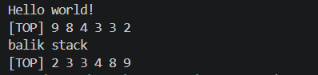

# <h1 align="center">Laporan Praktikum Modul 7 - Stack</h1>
<p align="center">Muhammad Rozi Lazuardi - 109082500188</p>

## Dasar Teori
Stack atau yang biasa disebut sebagai tumpukan merupakan salah satu bentuk struktur data linier yang mengikuti prinsip kerja LIFO (Last In, First Out), di mana elemen yang terakhir kali dimasukkan ke dalam tumpukan akan menjadi elemen pertama yang keluar atau diambil. Operasi penambahan dan penghapusan data pada stack hanya dapat dilakukan pada satu ujung saja yang biasa disebut sebagai TOP (puncak tumpukan).

### A. Representasi dan Karakteristik Stack<br/>
Dalam penerapannya di bidang ilmu komputer dan pemrograman, struktur data stack memiliki beberapa karakteristik dan mekanisme utama yang mendasari pengelolaannya.
#### 1. Prinsip Kerja LIFO (Last In, First Out)
Prinsip kerja tumpukan di mana elemen yang diletakkan paling akhir berada di posisi paling atas dan wajib diambil terlebih dahulu.
#### 2. Operasi Dasar pada Stack (Push dan Pop)
Operasi utama berupa Push untuk menambahkan elemen ke puncak tumpukan serta Pop untuk mengambil dan menghapus elemen teratas.
#### 3. Implementasi Berbasis Array dan Pointer
Struktur data stack dapat direpresentasikan menggunakan array statis dengan batas kapasitas maupun dinamis menggunakan pointer.

### B. Analisis Algoritma dan Manipulasi Data<br/>
Pengelolaan stack juga dilengkapi dengan fungsi tambahan untuk memproses dan memanipulasi elemen di dalamnya.
#### 1. Inisialisasi dan Pengecekan Kosong
Fungsi createStack untuk menginisialisasi tumpukan awal dan isEmpty guna memeriksa apakah tumpukan sedang kosong.
#### 2. Penyisipan Terurut (Push Ascending)
Algoritma pushAscending untuk menyisipkan data baru secara otomatis dalam kondisi terurut dari kecil ke besar.
#### 3. Pembalikan Elemen (Balik Stack)
Prosedur balikStack yang digunakan untuk membalikkan urutan posisi seluruh elemen di dalam tumpukan.

## Guided 

### 1. STACK

```C++
main.cpp
#include <iostream>
#include <cstring>
#include "stack.h"
using namespace std;

int main() {
    Stack S;
    infotype data, hasil;

    createStack(S);
    cout << "Stack baru dibuat, Top = " << S.Top << endl;
    viewStack(S);

    cout << endl << "---Push 3 Data---" << endl;
    strcpy(data.nim, "109082500202");
    strcpy(data.nama, "Andi");
    push(S, data);

    strcpy(data.nim, "109082500203");
    strcpy(data.nama, "Budi");
    push(S, data);

    strcpy(data.nim, "109082500204");
    strcpy(data.nama, "Citra");
    push(S, data);
    viewStack(S);

    cout << endl << "---Pop 1 Data---" << endl;
    pop(S, hasil);
    cout << "Data yang di ambil: " << hasil.nim << " - " << hasil.nama << endl;
    viewStack(S);

    cout << endl << "---Pop sampai kosong---" << endl;
    pop(S, hasil);
    pop(S, hasil);
    pop(S, hasil); 
    viewStack(S);

    return 0;
}

stack.cpp
#include "stack.h"

int isEmpty(Stack S) {
    if (S.Top == 0) {
        return 0; 
    } else {
        return 1; 
    }
}

void createStack(Stack &S) {
    S.Top = 0; 
}

void push(Stack &S, infotype X) {
    if (S.Top < 10) {
        S.Top = S.Top + 1;
        S.info[S.Top - 1] = X; 
    } else {
        cout << "Stack Penuh, data tidak dapat ditambahkan" << endl;
    }
}

void pop(Stack &S, infotype &X) {
    if (isEmpty(S) != 0) {
        X = S.info[S.Top - 1]; 
        S.Top = S.Top - 1; 
    } else {
        cout << "Stack Kosong, tidak ada data yang dapat diambil" << endl;
    }
}

void viewStack(Stack S) {
    if (isEmpty(S) == 0) {
        cout << "Stack Kosong" << endl;
    } else {
        cout << "Isi Stack: " << endl;
        for (int i = S.Top; i >= 1; i--) {
            cout << i << ". " << S.info[i - 1].nim << " - " << S.info[i - 1].nama << endl;
        }
    }
}

stack.h
#ifndef STACK_H
#define STACK_H

typedef int infotype;

struct Stack {
    infotype info[20];
    int top;
};

void createStack(Stack &s);
void push(Stack &s, infotype x);
infotype pop(Stack &s);
void printInfo(Stack s);
void balikStack(Stack &s);

void pushAscending(Stack &s, infotype x);
void getInputStream(Stack &s);

#endif
```
Program ini adalah implementasi struktur data Stack (tumpukan) berbasis array dalam C++ yang menerapkan prinsip LIFO (Last In, First Out). Program ini dibagi menjadi tiga file: stack.h untuk deklarasi struktur dan fungsi, stack.cpp untuk kode logika fungsi seperti createStack, isEmpty, push, pop, dan viewStack, serta main.cpp untuk menguji jalannya program. Di dalam main.cpp, program menginisialisasi stack, memasukkan tiga data mahasiswa (NIM dan nama) menggunakan push, menampilkan isinya, lalu menguji pengambilan data menggunakan pop hingga stack kembali kosong.


## Unguided 

### 1. Buatlah ADT Stack menggunakan ARRAY sebagai berikut di dalam file “stack.h”. Buatlah implementasi ADT Stack menggunakan Array pada file “stack.cpp” dan “main.cpp”. Buatlah implementasi ADT Stack menggunakan Array pada file “stack.cpp” dan “main.cpp”. Tambahkan prosedur getInputStream( in/out S : Stack ). Prosedur akan terus membaca dan menerima input user dan memasukkan setiap input ke dalam stack hingga user menekan tombol enter. Contoh: gunakan cin.get() untuk mendapatkan inputan user.

```C++
main.cpp
#include <iostream>
#include "stack.h"

using namespace std;

int main() {
    cout << "Hello world!" << endl;

    Stack S;

    createStack(S);

    pushAscending(S, 3);
    pushAscending(S, 4);
    pushAscending(S, 8);
    pushAscending(S, 2);
    pushAscending(S, 3);
    pushAscending(S, 9);

    printInfo(S);

    cout << "balik stack" << endl;

    balikStack(S);

    printInfo(S);

    return 0;
}

stack.cpp
#include <iostream>
#include "stack.h"

using namespace std;

void createStack(Stack &s) {
    s.top = -1;
}

void push(Stack &s, infotype x) {
    if (s.top < 19) {
        s.top++;
        s.info[s.top] = x;
    } else {
        cout << "Stack penuh!" << endl;
    }
}

infotype pop(Stack &s) {
    if (s.top >= 0) {
        infotype x = s.info[s.top];
        s.top--;
        return x;
    } else {
        cout << "Stack kosong!" << endl;
        return -1;
    }
}

void printInfo(Stack s) {
    cout << "[TOP] ";

    for (int i = s.top; i >= 0; i--) {
        cout << s.info[i] << " ";
    }

    cout << endl;
}

void balikStack(Stack &s) {
    int kiri = 0;
    int kanan = s.top;

    while (kiri < kanan) {
        infotype temp = s.info[kiri];
        s.info[kiri] = s.info[kanan];
        s.info[kanan] = temp;

        kiri++;
        kanan--;
    }
}

void pushAscending(Stack &s, infotype x) {
    if (s.top < 19) {
        int i = s.top;

        while (i >= 0 && s.info[i] > x) {
            s.info[i + 1] = s.info[i];
            i--;
        }

        s.info[i + 1] = x;
        s.top++;
    } else {
        cout << "Stack penuh!" << endl;
    }
}

void getInputStream(Stack &s) {
    char input;

    cout << "Masukkan angka: ";

    while (cin.get(input) && input != '\n') {
        if (input >= '0' && input <= '9') {
            push(s, input - '0');
        }
    }
}

stack.h
#ifndef STACK_H
#define STACK_H

typedef int infotype;

struct Stack {
    infotype info[20];
    int top;
};

void createStack(Stack &s);
void push(Stack &s, infotype x);
infotype pop(Stack &s);
void printInfo(Stack s);
void balikStack(Stack &s);

void pushAscending(Stack &s, infotype x);
void getInputStream(Stack &s);

#endif
```
### Output Unguided 1 :

##### Output 1


Program ini adalah implementasi struktur data Stack (tumpukan) berbasis array berkapasitas 20 elemen dalam C++ yang menerapkan prinsip LIFO (Last In, First Out). Program ini terbagi ke dalam tiga file utama, yaitu stack.h sebagai deklarasi struktur dan fungsi, stack.cpp yang berisi kode logika fungsi dasar serta fungsi tambahan seperti pushAscending (untuk menyisipkan data secara terurut dari kecil ke besar dengan menggeser elemen) dan balikStack (untuk membalik posisi elemen tumpukan), serta main.cpp sebagai program utama yang menguji pengisian beberapa angka secara terurut, mencetak isi tumpukan, lalu membalik dan menampilkan hasil akhirnya. 


## Kesimpulan
Program ini berhasil mengimplementasikan struktur data Stack berbasis array dalam C++ yang menerapkan prinsip LIFO (Last In, First Out). Program ini dilengkapi dengan fungsi-fungsi utama seperti push, pop, dan printInfo, serta fitur tambahan berupa pushAscending untuk menyisipkan data secara terurut dari nilai terkecil dan balikStack untuk membalik urutan elemen tumpukan. Melalui file pengujian main.cpp, program mampu menjalankan operasi pemasukan data secara terurut, menampilkan kondisi [TOP], hingga membalik posisi seluruh elemen dengan baik.

## Referensi
[1] Triase. (2020). Diktat Edisi Revisi : STRUKTUR DATA. Medan: UNIVERSTAS ISLAM NEGERI SUMATERA UTARA MEDAN. 
<br>[2] Indahyati, Uce., Rahmawati Yunianita. (2020). "BUKU AJAR ALGORITMA DAN PEMROGRAMAN DALAM BAHASA C++". Sidoarjo: Umsida Press. Diakses pada 10 Maret 2024 melalui https://doi.org/10.21070/2020/978-623-6833-67-4.
<br>...
