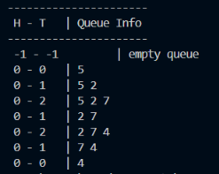
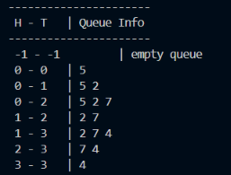
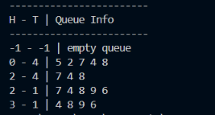

# <h1 align="center">Laporan Praktikum Modul 8 - Queue</h1>

<p align="center">Muhammad Rozi Lazuardi - 109082500188</p>

## Dasar Teori

Queue adalah struktur data antrean berprinsip FIFO (First-In, First-Out), yaitu data yang masuk pertama keluar pertama [1, 2]. Pada C++, queue dapat dibuat memakai linked list atau array dengan penunjuk head dan tail[cite: 1, 6, 11].
Pada array, pengelolaan head dan tail terbagi menjadi Alternatif 1 (head tetap, tail bergerak dan elemen digeser saat dequeue), Alternatif 2 (head dan tail maju, geser elemen saat penuh semu), serta Alternatif 3 (circular queue memakai modulo tanpa geser elemen)[cite: 5, 6, 7, 11]. Pada linked list, tambah data umumnya di tail dan hapus data di head dengan memori dinamis[cite: 1, 2, 3, 4].

### A. Konsep Dasar Queue dan Operasi Utama<br/>

Operasi utama queue adalah enqueue (tambah di belakang/tail) dan dequeue (hapus di depan/head)[cite: 1, 2, 3, 11].

#### 1. Prinsip FIFO (First-In, First-Out)

Data masuk melewati tail dan keluar melewati head sesuai urutan kedatangan[cite: 1, 2, 3].

#### 2. Representasi Linked List vs Array

Linked list bersifat dinamis dengan alokasi dan dealokasi memori, sedangkan array berukuran tetap dengan indeks head dan tail[cite: 1, 4, 5, 11].

#### 3. Kondisi Kosong dan Penuh

Pada array mulai indeks 0, queue kosong ditandai head = -1 dan tail = -1, sedangkan kondisi penuh mengikuti aturan tiap alternatif[cite: 5, 6, 7, 10, 11].

### B. Variasi Implementasi Queue pada Array<br/>

Perbedaan implementasi array terletak pada pergerakan indeks head dan tail saat enqueue dan dequeue[cite: 5, 6, 7, 11].

#### 1. Alternatif 1 (Head Diam, Tail Bergerak)

Head tetap di indeks 0, tail maju saat enqueue, dan elemen digeser ke kiri saat dequeue[cite: 5, 11].

#### 2. Alternatif 2 (Head Bergerak, Tail Bergerak)

Head maju saat dequeue tanpa geser elemen, dan elemen baru digeser ke awal array saat tail mentok namun head > 0[cite: 6, 11].

#### 3. Alternatif 3 (Head dan Tail Berputar)

Head dan tail bergerak melingkar dengan modulo kapasitas array sehingga ruang kosong di depan bisa langsung dipakai tanpa geser elemen[cite: 7, 11].

## Guided

### 1. Queue

```C++
main.cpp
#include <iostream>
#include "queue.h"
using namespace std;

int main() {
    queue Q;
    address P;

    CreateQueue(Q);
    cout << "isEmpty : " << isEmpty(Q) << endl;
    printInfo(Q);

    insert(Q, alokasi(5));
    insert(Q, alokasi(2));
    insert(Q, alokasi(7));
    cout << "Setelah insert 5, 2, 7" << endl;
    printInfo(Q);
    cout << "nbList  : " << nbList(Q) << endl;

    P = findElm(Q, 2);
    if (P != Nil) {
        cout << "findElm(2) ketemu, info = " << P->info << endl;
        cout << "fFindElm : " << fFindElm(Q, P) << endl;
    }
    if (findElm(Q, 9) == Nil) {
        cout << "findElm(9) tidak ketemu" << endl;
    }

    deleteQueue(Q, P);
    cout << "Setelah delete, elemen yang keluar = " << P->info << endl;
    dealokasi(P);
    printInfo(Q);

    delAll(Q);
    cout << "Setelah delAll" << endl;
    printInfo(Q);
    cout << "isEmpty : " << isEmpty(Q) << endl;

    return 0;
}

queue.cpp
#include "queue.h"

boolean isEmpty(queue Q) {
    return (Q.head == Nil);
}

void CreateQueue(queue &Q) {
    Q.head = Nil;
    Q.tail = Nil;
}

address alokasi(infotype X) {
    address P = new (nothrow) elmQ;
    if (P != Nil) {
        P->info = X;
        P->next = Nil;
    }
    return P;
}

void dealokasi(address P) {
    delete P;
}

address findElm(queue Q, infotype X) {
    address P = Q.head;
    while (P != Nil) {
        if (P->info == X) {
            return P;
        }
        P = P->next;
    }
    return Nil;
}

boolean fFindElm(queue Q, address P) {
    address R = Q.head;
    while (R != Nil) {
        if (R == P) {
            return true;
        }
        R = R->next;
    }
    return false;
}

void insert(queue &Q, address P) { //enqueue
    if (isEmpty(Q)) {
        Q.head = P;
        Q.tail = P;
    } else {
        (Q.tail)->next = P;
        Q.tail = P;
    }
}

void deleteQueue(queue &Q, address &P) { //dequeue
    P = Q.head;
    if (Q.head == Q.tail) {
        Q.head = Nil;
        Q.tail = Nil;
    } else {
        Q.head = P->next;
    }
    P->next = Nil;
}

void printInfo(queue Q) {
    if (isEmpty(Q)) {
        cout << "Queue kosong" << endl;
    } else {
        address P = Q.head;
        while (P != Nil) {
            cout << P->info << " ";
            P = P->next;
        }
        cout << endl;
    }
}

int nbList(queue Q) {
    int jumlah = 0;
    address P = Q.head;
    while (P != Nil) {
        jumlah++;
        P = P->next;
    }
    return jumlah;
}

void delAll(queue &Q) {
    address P;
    while (!isEmpty(Q)) {
        deleteQueue(Q, P);
        dealokasi(P);
    }
}

queue.h
#ifndef QUEUE_H
#define QUEUE_H

#include <iostream>
using namespace std;

typedef int infotype;

struct Queue {
    infotype info[5];
    int head;
    int tail;
};

void CreateQueue(Queue &Q);
bool isEmptyQueue(Queue Q);
bool isFullQueue(Queue Q);
void enqueue(Queue &Q, infotype x);
infotype dequeue(Queue &Q);
void printInfo(Queue Q);

#endif

```

Program ini mengimplementasikan struktur data Queue (FIFO) berbasis linked list dengan pointer head (depan) dan tail (belakang) melalui file main.cpp (pengujian alur antrean) dan queue.cpp (logika operasi), meliputi pembuatan antrean kosong (CreateQueue), pengecekan kosong (isEmpty), alokasi dan dealokasi memori (alokasi, dealokasi, delAll), tambah data di belakang (insert), hapus data di depan (deleteQueue), cari data/alamat (findElm, fFindElm), hitung jumlah elemen (nbList), serta tampilkan isi antrean (printInfo).

### 2. Queue-array

```C++
main.cpp
#include "queue-array.h"
#include <iostream>

using namespace std;

int main(){
    queue Q;

    CreateQueue(Q);
    enQueue(Q, "Dimas");
    enQueue(Q, "Arvin");
    enQueue(Q, "Rizal");
    enQueue(Q, "Hafizh");
    enQueue(Q, "Fathur");
    enQueue(Q, "Daffa");
    cout << endl;

    cout << "--- Isi Queue Setelah enQueue ---" << endl;
    viewQueue(Q);
    cout << endl;

    deQueue(Q);
    deQueue(Q);
    deQueue(Q);
    deQueue(Q);
    // deQueue(Q);
    // deQueue(Q);
    cout << endl;

    cout << "--- Isi Queue Setelah deQueue ---" << endl;
    viewQueue(Q);

    return 0;
}

queue-array.cpp
#include "queue-array.h"
#include <iostream>

using namespace std;

// NOTE :
// Implementasi 1 = head diam, tail bergerak (Queue Linear Statis, kerana head nya tetap diam)
// Implementasi 2 = head bergerak, tail bergerak (Queue Linear Dinamis, karena head & tail nya sama-sama bergerak)
// Implementasi 3 = head dan tail berputar (Queue Circular, karena jika udh mentok tapi masih ada space, diputar sehingga tail bisa ada didepan head)

bool isEmpty(queue Q){
    if(Q.head == -1 && Q.tail == -1){
        return true;
    } else {
        return false;
    }
}

//isFull implmenetasi 1
bool isFull(queue Q){
    if(Q.tail == MAKSIMAL - 1){
        return true;
    } else {
        return false;
    }
}

// //isFull implementasi 2
// bool isFull(queue Q){
//     if(Q.head == 0 && Q.tail == MAKSIMAL - 1){
//         return true;
//     } else {
//         return false;
//     }
// }

// //isFull implementasi 3
// bool isFull(queue Q){
//     if((Q.tail + 1) % MAKSIMAL == Q.head){
//         return true;
//     } else {
//         return false;
//     }
// }

void CreateQueue(queue &Q){ //terbentuk queue dengan head = -1 dan tail = -1
    Q.head = -1;
    Q.tail = -1;
}


//enqueue implementasi 1
void enQueue(queue &Q, string nama){
    if(isFull(Q) == true){
        cout << "Queue sudah penuh!" << endl;
    } else {
        if(isEmpty(Q) == true){
            Q.head = Q.tail = 0;
        } else {
            Q.tail++;
        }
        Q.nama[Q.tail] = nama;
        cout << "nama " << nama << " berhasil ditambahkan kedalam queue!" << endl;
    }
}

// //enQueue implementasi 2
// void enQueue(queue &Q, string nama){
//     if(isFull(Q) == true){
//         cout << "Queue sudah penuh!" << endl;
//     } else {
//         if(isEmpty(Q) == true){
//             Q.head = Q.tail = 0;
//         } else {
//             if(Q.tail == MAKSIMAL - 1){ // penuh semu, geser elemen ke kiri
//                 int selisih = Q.head;
//                 for(int i = Q.head; i <= Q.tail; i++){
//                     Q.nama[i - selisih] = Q.nama[i];
//                 }
//                 Q.tail = Q.tail - selisih;
//                 Q.head = 0;
//             }
//             Q.tail++;
//         }
//         Q.nama[Q.tail] = nama;
//         cout << "nama " << nama << " berhasil ditambahkan kedalam queue!" << endl;
//     }
// }

// //enQueue implementasi 3
// void enQueue(queue &Q, string nama){
//     if(isFull(Q) == true){
//         cout << "Queue sudah penuh!" << endl;
//     } else {
//         if(isEmpty(Q) == true){
//             Q.head = Q.tail = 0;
//         } else {
//             Q.tail = (Q.tail + 1) % MAKSIMAL; // bergerak melingkar
//         }
//         Q.nama[Q.tail] = nama;
//         cout << "nama " << nama << " berhasil ditambahkan kedalam queue!" << endl;
//     }
// }

//dequeue implementasi 1
void deQueue(queue &Q){
    if(isEmpty(Q) == true){
        cout << "Queue kosong!" << endl;
    } else {
        cout << "Mengahapus data " << Q.nama[Q.head] << "..." << endl;
        for(int i = 0; i < Q.tail; i++){
            Q.nama[i] =  Q.nama[i+1];
        }
        Q.tail--;
        if(Q.tail < 0){ //kalo semua isi queue nya udh dikeluarin, set head & tail ke -1
            Q.head = -1;
            Q.tail = -1;
        }
    }
}

// //dequeue implementasi 2
// void deQueue(queue &Q){
//     if(isEmpty(Q) == true){
//         cout << "Queue kosong!" << endl;
//     } else {
//         cout << "Mengahapus data " << Q.nama[Q.head] << "..." << endl;
//         Q.head++;
//         if(Q.head > Q.tail){ //kalo elemennya udh abis (head akan lebih 1 dari tail), maka reset ulang head & tail ke -1
//             Q.head = -1;
//             Q.tail = -1;
//         }
//     }
// }

// //deQueue implementasi 3
// void deQueue(queue &Q){
//     if(isEmpty(Q) == true){
//         cout << "Queue kosong!" << endl;
//     } else {
//         cout << "Mengahapus data " << Q.nama[Q.head] << "..." << endl;
//         if(Q.head == Q.tail){ //kalo elemennya tinggal 1, langsungkan saja head & tail nya reset ke -1
//             Q.head = -1;
//             Q.tail = -1;
//         } else {
//             Q.head = (Q.head + 1) % MAKSIMAL; // bergerak melingkar
//         }
//     }
// }

//viewQueue implementasi 1 & 2
void viewQueue(queue Q){
    if(isEmpty(Q) == true){
        cout << "Queue kosong!" << endl;
    } else {
        for(int i = Q.head; i <= Q.tail; i++){
            cout << i -  Q.head + 1 << ". " << Q.nama[i] << endl;
        }
    }
    cout << endl;
}

// //viewQueue implementasi 3
// void viewQueue(queue Q){
//     if(isEmpty(Q) == true){
//         cout << "Queue kosong!" << endl;
//     } else {
//         int i = Q.head;
//         int count = 1;
//         while(true){
//             cout << count << ". " << Q.nama[i] << endl;
//             if(i == Q.tail){
//                 break;
//             }
//             i = (i + 1) % MAKSIMAL;
//             count++;
//         }
//     }
// }

queue-array.h
#ifndef QUEUE_H
#define QUEUE_H

#include <iostream>
using namespace std;

const int MAKSIMAL = 5;

struct queue {
    string nama[MAKSIMAL];
    int head;
    int tail;
};

bool isFull(queue Q);
bool isEmpty(queue Q);
void CreateQueue(queue &Q);
void enQueue(queue &Q, string nama);
void deQueue(queue &Q);
void viewQueue(queue Q);

#endif
```

Program ini mengimplementasikan struktur data Queue (FIFO) bertipe string (nama) berbasis array berkapasitas tetap (MAKSIMAL = 5) dengan pointer indeks head dan tail melalui file queue-array.h (definisi struktur dan prototipe), queue-array.cpp (operasi CreateQueue, isEmpty, isFull, enQueue, deQueue, dan viewQueue dengan komentar referensi 3 skenario/implementasi queue), serta main.cpp (pengujian tambah, lihat, dan hapus data antrean).

## Unguided

### 1. Buatlah ADT Queue menggunakan ARRAY sebagai berikut di dalam file “queue.h”. Buatlah implementasi ADT Queue pada file “queue.cpp” dengan menerapkan mekanisme queue Alternatif 1 (head diam, tail bergerak).

```C++
main.cpp
#include <iostream>
#include "queue.h"

using namespace std;

int main() {
    Queue Q;
    CreateQueue(Q);

    cout << "----------------------" << endl;
    cout << " H - T \t | Queue Info" << endl;
    cout << "----------------------" << endl;
    printInfo(Q);
    enqueue(Q, 5); printInfo(Q);
    enqueue(Q, 2); printInfo(Q);
    enqueue(Q, 7); printInfo(Q);
    dequeue(Q);    printInfo(Q);
    enqueue(Q, 4); printInfo(Q);
    dequeue(Q);    printInfo(Q);
    dequeue(Q);    printInfo(Q);

    return 0;
}

queue.cpp
#include "queue.h"

void CreateQueue(Queue &Q) {
    Q.head = -1;
    Q.tail = -1;
}

bool isEmptyQueue(Queue Q) {
    return (Q.head == -1 && Q.tail == -1);
}

bool isFullQueue(Queue Q) {
    return (Q.tail == 4);
}

void enqueue(Queue &Q, infotype x) {
    if (isFullQueue(Q)) {
        cout << "Queue penuh" << endl;
    } else {
        if (isEmptyQueue(Q)) {
            Q.head = 0;
            Q.tail = 0;
        } else {
            Q.tail++;
        }
        Q.info[Q.tail] = x;
    }
}

infotype dequeue(Queue &Q) {
    infotype x = -1;
    if (isEmptyQueue(Q)) {
        cout << "Queue kosong" << endl;
    } else {
        x = Q.info[Q.head];
        if (Q.head == Q.tail) {
            CreateQueue(Q);
        } else {
            for (int i = Q.head; i < Q.tail; i++) {
                Q.info[i] = Q.info[i + 1];
            }
            Q.tail--;
        }
    }
    return x;
}

void printInfo(Queue Q) {
    cout << " " << Q.head << " - " << Q.tail << " \t | ";
    if (isEmptyQueue(Q)) {
        cout << "empty queue";
    } else {
        for (int i = Q.head; i <= Q.tail; i++) {
            cout << Q.info[i] << " ";
        }
    }
    cout << endl;
}

queue.h
#ifndef QUEUE_H
#define QUEUE_H

#include <iostream>
using namespace std;

typedef int infotype;

struct Queue {
    infotype info[5];
    int head;
    int tail;
};

void CreateQueue(Queue &Q);
bool isEmptyQueue(Queue Q);
bool isFullQueue(Queue Q);
void enqueue(Queue &Q, infotype x);
infotype dequeue(Queue &Q);
void printInfo(Queue Q);

#endif

```

### Output Unguided 1 :

##### Output



Program ini mengimplementasikan struktur data Queue (FIFO) bertipe int (infotype) berbasis array berkapasitas 5 elemen (info[5]) dengan mekanisme head diam, tail bergerak (menggeser elemen ke kiri saat dequeue dan menurunkan tail), melalui file queue.h (definisi struktur dan prototipe), queue.cpp (operasi CreateQueue, isEmptyQueue, isFullQueue, enqueue, dequeue, dan printInfo), serta main.cpp (pengujian tambah, hapus, dan cetak status head - tail beserta isi antrean).

### 2. Buatlah implementasi ADT Queue pada file “queue.cpp” dengan menerapkan mekanisme queue Alternatif 2 (head bergerak, tail bergerak).

```C++
main.cpp
#include <iostream>
#include "queue.h"

using namespace std;

int main() {
    Queue Q;
    CreateQueue(Q);

    cout << "----------------------" << endl;
    cout << " H - T \t | Queue Info" << endl;
    cout << "----------------------" << endl;
    printInfo(Q);
    enqueue(Q, 5); printInfo(Q);
    enqueue(Q, 2); printInfo(Q);
    enqueue(Q, 7); printInfo(Q);
    dequeue(Q);    printInfo(Q);
    enqueue(Q, 4); printInfo(Q);
    dequeue(Q);    printInfo(Q);
    dequeue(Q);    printInfo(Q);

    return 0;
}

queue.cpp
#include "queue.h"

void CreateQueue(Queue &Q) {
    Q.head = -1;
    Q.tail = -1;
}

bool isEmptyQueue(Queue Q) {
    return (Q.head == -1 && Q.tail == -1);
}

bool isFullQueue(Queue Q) {
    return (Q.head == 0 && Q.tail == 4);
}

void enqueue(Queue &Q, infotype x) {
    if (isFullQueue(Q)) {
        cout << "Queue penuh" << endl;
    } else {
        if (isEmptyQueue(Q)) {
            Q.head = 0;
            Q.tail = 0;
        } else {
            if (Q.tail == 4) {
                int j = 0;
                for (int i = Q.head; i <= Q.tail; i++) {
                    Q.info[j] = Q.info[i];
                    j++;
                }
                Q.head = 0;
                Q.tail = j;
            } else {
                Q.tail++;
            }
        }
        Q.info[Q.tail] = x;
    }
}

infotype dequeue(Queue &Q) {
    infotype x = -1;
    if (isEmptyQueue(Q)) {
        cout << "Queue kosong" << endl;
    } else {
        x = Q.info[Q.head];
        if (Q.head == Q.tail) {
            CreateQueue(Q);
        } else {
            Q.head++;
        }
    }
    return x;
}

void printInfo(Queue Q) {
    cout << " " << Q.head << " - " << Q.tail << " \t | ";
    if (isEmptyQueue(Q)) {
        cout << "empty queue";
    } else {
        for (int i = Q.head; i <= Q.tail; i++) {
            cout << Q.info[i] << " ";
        }
    }
    cout << endl;
}

queue.h
#ifndef QUEUE_H
#define QUEUE_H

#include <iostream>
using namespace std;

typedef int infotype;

struct Queue {
    infotype info[5];
    int head;
    int tail;
};

void CreateQueue(Queue &Q);
bool isEmptyQueue(Queue Q);
bool isFullQueue(Queue Q);
void enqueue(Queue &Q, infotype x);
infotype dequeue(Queue &Q);
void printInfo(Queue Q);

#endif

```

### Output Unguided 2 :

##### Output



Program ini mengimplementasikan struktur data Queue (FIFO) bertipe int (infotype) berbasis array berkapasitas 5 elemen (info[5]) dengan mekanisme head bergerak, tail bergerak (menggeser head saat dequeue dan menggeser elemen ke awal array saat terjadi penuh semu di tail == 4), melalui file queue.h (definisi struktur dan prototipe), queue.cpp (operasi CreateQueue, isEmptyQueue, isFullQueue, enqueue, dequeue, dan printInfo), serta main.cpp (pengujian tambah, hapus, dan cetak status head - tail beserta isi antrean).

### 3. Buatlah implementasi ADT Queue pada file “queue.cpp” dengan menerapkan mekanisme queue Alternatif 3 (head dan tail berputar).

```C++
main.cpp
#include <iostream>
#include "queue.h"

using namespace std;

int main() {
    Queue Q;
    createQueue(Q);

    cout << "------------------------" << endl;
    cout << "H - T | Queue Info" << endl;
    cout << "------------------------" << endl;

    printInfo(Q);

    enqueue(Q, 5);
    enqueue(Q, 2);
    enqueue(Q, 7);
    enqueue(Q, 4);
    enqueue(Q, 8);
    printInfo(Q);

    dequeue(Q);
    dequeue(Q);
    printInfo(Q);

    enqueue(Q, 9);
    enqueue(Q, 6);
    printInfo(Q);

    dequeue(Q);
    printInfo(Q);

    return 0;
}

queue.cpp
#include <iostream>
#include "queue.h"

using namespace std;

void createQueue(Queue &Q) {
    Q.head = -1;
    Q.tail = -1;
}

bool isEmptyQueue(Queue Q) {
    return Q.head == -1;
}

bool isFullQueue(Queue Q) {
    return (Q.tail + 1) % 5 == Q.head;
}

void enqueue(Queue &Q, infotype x) {
    if (isFullQueue(Q)) {
        cout << "Queue penuh" << endl;
    } else {
        if (isEmptyQueue(Q)) {
            Q.head = 0;
            Q.tail = 0;
        } else {
            Q.tail = (Q.tail + 1) % 5;
        }

        Q.info[Q.tail] = x;
    }
}

infotype dequeue(Queue &Q) {
    if (isEmptyQueue(Q)) {
        cout << "Queue kosong" << endl;
        return -1;
    } else {
        infotype x = Q.info[Q.head];

        if (Q.head == Q.tail) {
            Q.head = -1;
            Q.tail = -1;
        } else {
            Q.head = (Q.head + 1) % 5;
        }

        return x;
    }
}

void printInfo(Queue Q) {
    cout << Q.head << " - " << Q.tail << " | ";

    if (isEmptyQueue(Q)) {
        cout << "empty queue";
    } else {
        int i = Q.head;

        while (true) {
            cout << Q.info[i] << " ";

            if (i == Q.tail) {
                break;
            }

            i = (i + 1) % 5;
        }
    }

    cout << endl;
}

queue.h
#ifndef QUEUE_H
#define QUEUE_H

typedef int infotype;

struct Queue {
    infotype info[5];
    int head, tail;
};

void createQueue(Queue &Q);
bool isEmptyQueue(Queue Q);
bool isFullQueue(Queue Q);
void enqueue(Queue &Q, infotype x);
infotype dequeue(Queue &Q);
void printInfo(Queue Q);

#endif
```

### Output Unguided 3 :

##### Output



Program ini mengimplementasikan struktur data Queue (FIFO) bertipe int (infotype) berbasis array berkapasitas 5 elemen (info[5]) dengan mekanisme head dan tail berputar (circular queue menggunakan operasi modulo % 5 tanpa pergeseran elemen), melalui file queue.h (definisi struktur dan prototipe), queue.cpp (operasi createQueue, isEmptyQueue, isFullQueue, enqueue, dequeue, dan printInfo), serta main.cpp (pengujian tambah, hapus, dan cetak status head - tail beserta isi antrean).

## Kesimpulan

Struktur data queue bekerja dengan prinsip FIFO sehingga elemen pertama yang masuk selalu dikeluarkan lebih dulu, dan dapat diterapkan melalui representasi linked list yang dinamis maupun array dengan ukuran tetap. Pada implementasi queue berbasis array, pemilihan mekanisme pengelolaan indeks head dan tail memengaruhi efisiensi operasi enqueue dan dequeue, mulai dari pergeseran elemen pada Alternatif 1 dan Alternatif 2 hingga pergerakan melingkar menggunakan operasi modulo pada Alternatif 3 tanpa pergeseran elemen.

## Referensi

[1] Triase. (2020). Diktat Edisi Revisi : STRUKTUR DATA. Medan: UNIVERSTAS ISLAM NEGERI SUMATERA UTARA MEDAN.
<br>[2] Indahyati, Uce., Rahmawati Yunianita. (2020). "BUKU AJAR ALGORITMA DAN PEMROGRAMAN DALAM BAHASA C++". Sidoarjo: Umsida Press. Diakses pada 10 Maret 2024 melalui https://doi.org/10.21070/2020/978-623-6833-67-4.
